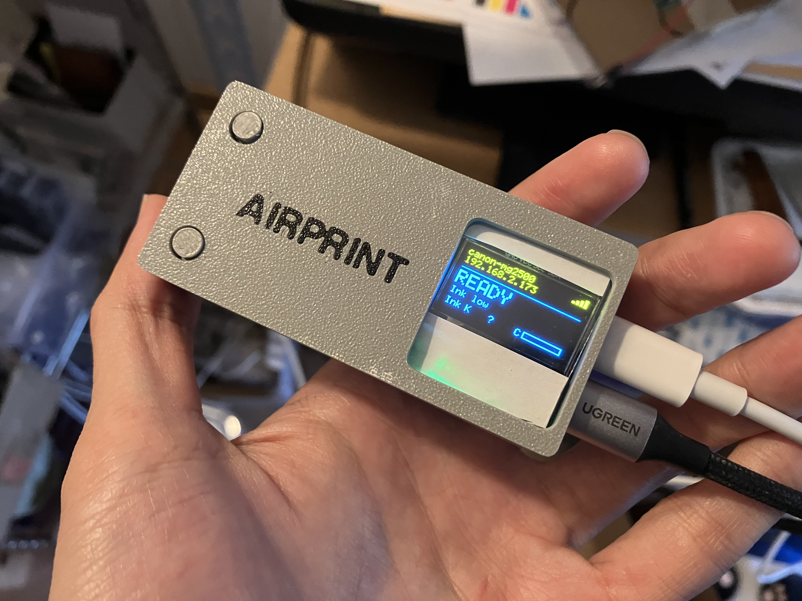
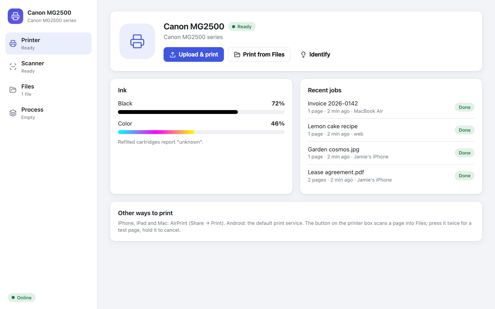
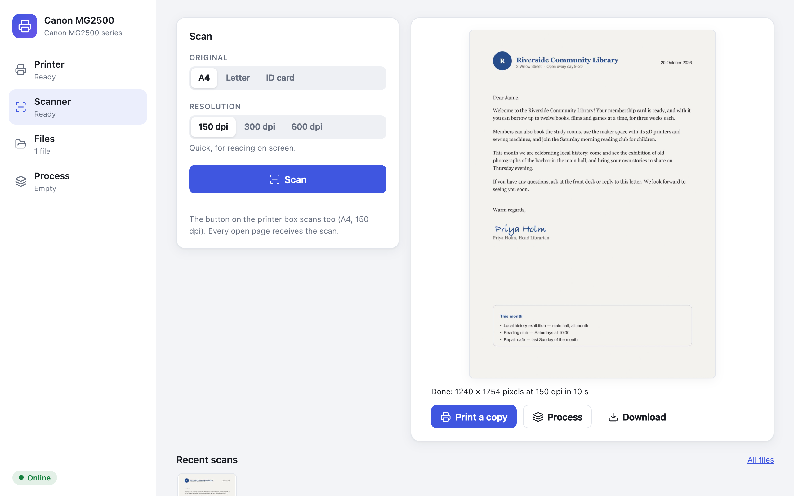
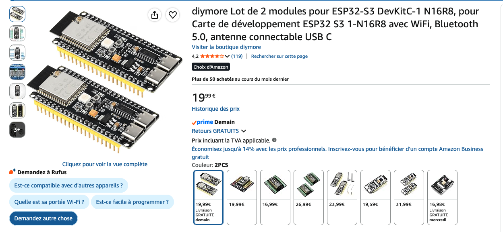
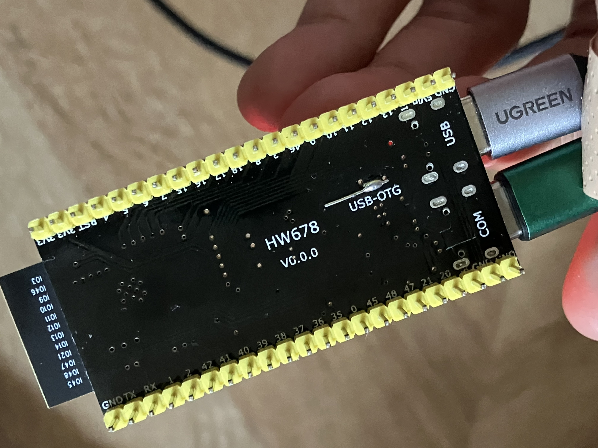
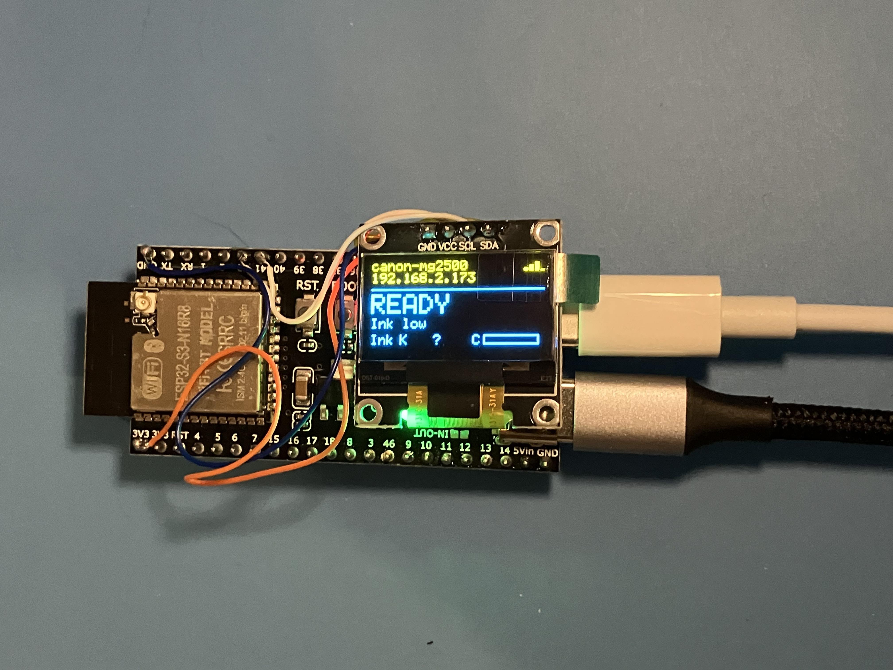

# Canon LBP2900 AirPrint trên VNPT SmartBox 2 S805

Port IPP/AirPrint và driver CAPT cho Canon LBP2900/LBP2900B sang Linux ARMHF.
Box đóng vai trò print server qua mạng LAN, không cần CUPS và không cần cài
driver Canon CAPT trên máy Windows.

> **Trạng thái (19/11/2026): beta, đã kiểm thử trên máy thật.** Windows 10 đã
> in thành công nhiều Test Page liên tiếp qua IPP tới Canon LBP2900 USB
> `04a9:2676`. Bản hiện tại giới hạn đầu vào ở `image/urf` và
> `image/pwg-raster`, tự hủy job mồ côi, dùng page ID do máy in cấp và chạy lại
> chuỗi khởi tạo CAPT cho mỗi job để tránh `NOPAPER` giả. Sau khi nâng cấp bản
> cũ, cần xóa và thêm lại máy in trên Windows để làm mới capability đã cache.

## Cấu hình đã kiểm thử

| Thành phần | Cấu hình |
|---|---|
| Box | VNPT SmartBox 2, Amlogic S805 |
| Hệ điều hành | Debian 11.11 Bullseye ARMHF |
| Kernel | Linux 3.10.33 (kernel Android của nhà sản xuất) |
| Init | SysV init, điều khiển bằng `service` |
| Máy in | Canon LBP2900/LBP2900B, USB ID `04a9:2676` |
| Máy khách | Windows 10 IoT Enterprise LTSC 2021, PowerShell 5.1 |
| Giao thức | IPP trên cổng 631; trang trạng thái trên cổng 8080 |
| Định dạng | URF/PWG Raster, đơn sắc 600 dpi, A4/Letter |

Image Debian gốc của box dùng SysV init nên **không dùng `systemctl`**. Lệnh
tương đương là `service lbp2900-airprint ...`. Muốn dùng `systemctl` phải thay
toàn bộ userspace bằng image systemd tương thích với kernel/bootloader S805;
điều đó không cần thiết để chạy print server này.

## 1. Kiểm tra box và máy in

SSH vào box bằng tài khoản `root`, sau đó chạy từng lệnh:

```sh
uname -a
cat /etc/debian_version
dpkg --print-architecture
df -h /
free -h
lsusb -d 04a9:2676
ls -l /dev/bus/usb/*/*
```

Kết quả quan trọng:

- kiến trúc là `armhf` hoặc `armv7l`;
- `lsusb` thấy `04a9:2676 Canon, Inc. LBP2900`;
- nên còn ít nhất 200 MB trống. Rootfs gốc khoảng 550 MB rất dễ đầy; nên mở
  rộng phân vùng lên tối thiểu 1 GB, cấu hình đã thử thực tế là 5.4 GB.

Nếu ping IP được nhưng APT báo lỗi phân giải tên, kiểm tra DNS:

```sh
ping -c 2 1.1.1.1
getent hosts deb.debian.org
cat /etc/resolv.conf
```

Chỉ khi DNS hiện tại không hoạt động, sao lưu rồi đặt DNS LAN/công cộng:

```sh
cp -a /etc/resolv.conf /etc/resolv.conf.backup
printf 'nameserver 192.168.1.1\nnameserver 1.1.1.1\n' > /etc/resolv.conf
getent hosts deb.debian.org
```

## 2. Cài gói cần thiết trên Debian

```sh
apt-get update
apt-get install -y avahi-daemon usbutils ca-certificates
```

Kernel Android 3.10 của box giới hạn socket theo group Android. Thêm tài khoản
Avahi vào các group mạng (group không tồn tại sẽ được bỏ qua):

```sh
for g in inet net_raw net_admin net_bw_stats net_bw_acct; do
    getent group "$g" >/dev/null && usermod -aG "$g" avahi
done
service avahi-daemon restart
service avahi-daemon status
```

## 3. Chép source lên box

### Cách A — clone GitHub

```sh
apt-get install -y git
cd /root
git clone https://github.com/datsrt02/vnptsmb2-s805-canon-lbp2900-airprint.git
cd vnptsmb2-s805-canon-lbp2900-airprint
```

### Cách B — chép gói phát hành từ Windows

Trong PowerShell trên Windows, đứng tại thư mục chứa file `.tar.gz`:

```powershell
scp .\lbp2900-airprint-debian-s805-armhf.tar.gz root@192.168.1.33:/root/
```

Trên box:

```sh
cd /root
tar -xzf lbp2900-airprint-debian-s805-armhf.tar.gz
cd lbp2900-airprint-debian
```

## 4. Cài print server

Repo có sẵn binary ARMHF tĩnh, box không cần compiler:

```sh
sha256sum linux/lbp2900-airprint-armhf.bin
chmod +x linux/install-debian.sh
sh linux/install-debian.sh
```

SHA-256 của binary đã kiểm thử:

```text
65b4528f339c8a48a09b503096386b5dafe471894bde46808cfbf2980325589f
```

Installer thực hiện các việc sau:

- cài binary vào `/usr/local/sbin/lbp2900-airprint`;
- cài SysV script `/etc/init.d/lbp2900-airprint` và bật tự khởi động;
- đăng ký IPP/AirPrint với Avahi;
- khởi động lại print server và Avahi.

Kiểm tra sau khi cài:

```sh
service lbp2900-airprint status
service avahi-daemon status
ps aux | grep '[l]bp2900-airprint'
ss -ltn | grep -E ':631|:8080'
wget -qO- http://127.0.0.1:8080/
```

Từ một máy khác trong LAN, mở:

- trang trạng thái: `http://192.168.1.33:8080/`;
- IPP endpoint: `http://192.168.1.33:631/ipp/print`.

Thay `192.168.1.33` nếu DHCP cấp IP khác. Nên đặt DHCP reservation cho box.

## 5. Thêm Canon LBP2900 vào Windows 10 bằng PowerShell

Mở **Windows PowerShell bằng quyền Administrator**. Trước hết kiểm tra box:

```powershell
Test-NetConnection 192.168.1.33 -Port 631
Test-NetConnection 192.168.1.33 -Port 8080
```

Bật Print Spooler. Lỗi `The spooler service is not reachable` nghĩa là dịch
vụ này đang tắt:

```powershell
Set-Service -Name Spooler -StartupType Automatic
Start-Service -Name Spooler
Get-Service -Name Spooler
```

Nếu đã từng thêm máy in trước khi cập nhật server, liệt kê và xóa đúng hàng
đợi cũ để Windows không dùng capability đã cache:

```powershell
Get-Printer | Format-Table Name, DriverName, PortName -AutoSize
Remove-Printer -Name "TEN_HANG_DOI_CU"
Restart-Service -Name Spooler
```

Thêm lại bằng IPP:

```powershell
Add-Printer -IppURL "http://192.168.1.33:631/ipp/print"
Get-Printer | Format-Table Name, DriverName, PortName, PrinterStatus -AutoSize
```

Lưu ý:

- không truyền `-Name` cùng `-IppURL`; Windows tự lấy tên do IPP cung cấp và
  có thể cảnh báo tham số `-Name` bị bỏ qua;
- driver phải là **Microsoft IPP Class Driver**, không chọn Canon CAPT;
- không dùng Standard TCP/IP port, RAW 9100 hay LPR;
- nếu hàng đợi chỉ hiện `Connecting`, kiểm tra cổng 631, Print Spooler, rồi
  xóa/thêm lại hàng đợi như trên.

Mở giao diện quản lý máy in:

```powershell
Start-Process "ms-settings:printers"
```

Chọn máy in IPP vừa thêm → **Manage** → **Print a test page**. Theo dõi đồng
thời `http://192.168.1.33:8080/` để thấy job chuyển từ `job-printing` sang
`job-completed-successfully`.

## 6. Xử lý lỗi thường gặp

### Test Page in được nhưng PDF/Word chỉ báo Printing

Đây thường là hàng đợi Windows đã cache capability cũ (`application/octet-stream`)
hoặc một job mồ côi từ bản server cũ. Cập nhật binary, rồi xóa và thêm lại
máy in:

```powershell
Get-Printer | Format-Table Name, DriverName, PortName -AutoSize
Remove-Printer -Name "TEN_HANG_DOI_CU"
Restart-Service Spooler
Add-Printer -IppURL "http://192.168.1.33:631/ipp/print"
```

Đảm bảo `DriverName` là `Microsoft IPP Class Driver`. Hủy các job cũ nếu còn:

```powershell
Get-PrintJob -PrinterName "TEN_HANG_DOI" | Remove-PrintJob
```

### Web báo `printer-stopped`, `document-unprintable-error` hoặc 0 page

Kiểm tra USB và khởi động lại service:

```sh
lsusb -d 04a9:2676
service lbp2900-airprint restart
service lbp2900-airprint status
```

Tắt/bật nguồn máy in nếu CAPT đang giữ trạng thái lỗi. Kiểm tra giấy, nắp máy
và cartridge. Backend sẽ tự detach `usblp` khi in rồi trả interface sau job.

LBP2900 chỉ trả trạng thái CAPT chi tiết khi một job đang giữ USB, nên trang
web có thể vẫn ghi `Ready` lúc idle dù khay vừa hết giấy. Log `E capt: no paper`
và cờ CAPT `NOPAPER` sau chuỗi khởi tạo đầu job thường là trạng thái cảm biến
thật; nạp/chỉnh giấy rồi gửi lại job. Bản từ ngày 19/11/2026 luôn chạy lại chuỗi
khởi tạo CAPT cho mỗi IPP job để tránh `NOPAPER` giả ở job thứ hai liên tiếp.

### Lấy log trực tiếp

Việc dừng service sẽ hủy job đang chạy. Sau đó chạy foreground:

```sh
service lbp2900-airprint stop
/usr/local/sbin/lbp2900-airprint 2>&1 | tee /root/lbp2900-airprint.log
```

Nhấn `Ctrl+C`, rồi bật lại daemon:

```sh
service lbp2900-airprint start
```

### Không tự tìm thấy máy in trong Windows/iPhone

IPP thủ công vẫn dùng được khi mDNS bị chặn. Kiểm tra:

```sh
service avahi-daemon status
grep -n . /etc/avahi/services/lbp2900-airprint.service
```

Đảm bảo client và box ở cùng LAN/VLAN, router không bật AP/client isolation,
và firewall không chặn UDP 5353, TCP 631, TCP 8080.

## 7. Build lại từ source

Build native trên Linux (cần compiler và header Linux USBFS):

```sh
apt-get install -y build-essential
make -C linux clean all
```

Cross-build binary ARMHF tĩnh bằng Zig trên PC/Linux:

```sh
make -C linux armhf-static ZIG=/duong/dan/toi/zig
```

Chạy host self-test:

```sh
make -C host clean
make -C host bjl_host
./host/bjl_host
```

Chi tiết implementation Linux ở [linux/README.vi.md](linux/README.vi.md), kết
quả kiểm thử phần cứng ở
[HARDWARE-TEST-2026-11-18.md](HARDWARE-TEST-2026-11-18.md), và phân tích port
ở [PORT-ANALYSIS.vi.md](PORT-ANALYSIS.vi.md).

## 8. Gỡ cài đặt

```sh
service lbp2900-airprint stop
update-rc.d -f lbp2900-airprint remove
rm -f /etc/init.d/lbp2900-airprint
rm -f /etc/default/lbp2900-airprint
rm -f /etc/avahi/services/lbp2900-airprint.service
rm -f /usr/local/sbin/lbp2900-airprint
service avahi-daemon restart
```

## Bảo mật và giấy phép

Chỉ dùng trong LAN tin cậy: HTTP/IPP hiện không có TLS hay xác thực. Không
forward cổng 631/8080 ra Internet. Port Linux tái sử dụng driver GPL của dự
án gốc, xem [LICENSE](LICENSE) và [LICENSES/](LICENSES/).

---

## Tài liệu upstream ESP32-S3

Phần dưới đây là README của dự án ESP32 gốc được giữ lại để tham khảo. Bản
chạy trên S805 nằm trong thư mục `linux/` và không cần ESP32.

# Add AirPrint / AirScan support to your old printer, using just a cheap ESP32-S3

> [!IMPORTANT]
> This project is actively looking for contributors to add support for more printers. Most importantly, you need to really own the printer you add: every driver must be tested on the real hardware, not only in emulation. See [Adding a printer](#adding-a-printer) to get started.


Turns any USB-only printers into a wireless printer and scanner. An ESP32-S3 board plugs into the printer's USB port and joins your WiFi:

- **Print** from iPhone, iPad and Mac (AirPrint), Android (Mopria) and Linux, with no drivers or apps.
- **Scan** from any browser, from Image Capture and Preview on a Mac, or with the button on the board.
- **A web app** on your phone or computer: print PDFs and pictures, scan, keep the files in the browser, and put pages together (rotate, crop, ID card copies) into a PDF.



| | |
|---|---|
|  |  |
|  |  |

## Supported printers

| Series | Models | Scan |
|---|---|---|
| 🟠 LBP2900 | LBP2900 / LBP2900B (`04a9:2676`) | no scanner |
| 🟢 MG2500 | MG2550S | yes |
| 🟡 MG2400 | MG2410 to MG2490 | yes |
| 🟡 MG2500 | MG2510 to MG2590 (other than the MG2500S) | yes |
| 🟡 P200 | P200 | no scanner |
| 🟡 MG2900 | MG2910 to MG2990 | yes |
| 🟡 MG3000 | MG3010 to MG3090 | yes |
| 🟡 E470 | E470 to E478 | yes |
| 🟡 E460 | E460 to E468 | yes |
| 🟡 iP2800 | iP2810 to iP2899 | no scanner |
| 🟡 E3100 | E3170 to E3195 | yes |
| 🟡 TS3100 | TS3110 to TS3195 | yes |
| 🟡 MP230 | MP230 to MP237 | yes |
| 🟡 iP2700 | iP2700 to iP2788 | no scanner |
| 🟡 MP250, MP270, MP280 | MP250 to MP288 | yes |
| 🟡 MP490, MP493, MP495 | MP490 to MP499 | yes |
| 🟡 MX340, MX350 | MX340 to MX358 | yes (glass only) |
| 🟡 MX360, MX410, MX420 | MX360 to MX428 | yes (glass only) |

- 🟢 Validated on real printer
- 🟡 Expected to work, not tested on real hardware yet.
- 🟠 Experimental CAPT implementation: builds and passes the core host self-tests, but still
  needs validation on a real LBP2900 before it can be called supported.

The firmware recognises the printer when it is plugged in. Other printers? Please open an issue or a PR.

## What you need

Just one thing: An ESP32-S3 dev board with two USB-C ports:



Optionally: a SSD1315 OLED screen and a 3D-printed case, see later in this tutorial

## Setup

**Step 1: Hardware.** Plug the ESP32-S3 into your computer via the COM port on the ESP32 board (NOT the port labelled "USB")



**Step 2: Settings.** Build once (`pio run`): this creates `.env`. Edit it:
   ```
   WIFI_SSID=your-network
   WIFI_PASSWORD=your-password
   PRINTER_NAME=Canon LBP2900 (ESP32)
   HOSTNAME=canon-lbp2900
   MODE=debug
   ```
   `MODE=debug` lets you update the board over WiFi later (see below); `MODE=normal` does without. `.env` is git-ignored, so your WiFi password stays local.

**Step 3: Flash.** Connect the board's **COM** port to your computer and run `pio run -t upload`. PlatformIO finds the board's serial port; if several are connected, add `--upload-port /dev/cu.usbmodem…`.

## Using it

Plug the printer to the port labelled "USB"

NOTE: You may also need to bridge the "USB-OTG" solder join on the board, so that it supplies 5V to the printer. While the printer doesn't actively use 5V, it sense the USB plug using this signal.

- **The web app:** open `http://canon-lbp2900.local/` (your `HOSTNAME`) on your phone or computer.
- **The button on the board** (BOOT, or one on GPIO4): press to scan, press twice for a test page, hold 2 s to cancel.
- **Print from a phone or a Mac:** on an iPhone, Share → Print and pick the printer. On a Mac, add it in System Settings → Printers & Scanners.
- **Scan on a Mac:** open Image Capture (or Preview → File → Import from Scanner) and pick the printer.

For the LBP2900, printing is monochrome at 600 dpi on A4 or Letter. Scanning
and the button test page are unavailable. CAPT is bidirectional: use the
printer's normal USB printer-class interface and do not put a USB/IP or CUPS
backend between the ESP32 and the printer.

## Adding OLED screen and buttons

This step is **optional**, you can connect a SSD1315 OLED screen with the pinout below:

| OLED | ESP32-S3 |
|---|---|
| VCC | 3V3 |
| GND | GND |
| SCL | GPIO41 |
| SDA | GPIO42 |

Connect it before powering on: the board only looks for it at startup.



For buttons, wire each one between a pin and GND:

| Button | ESP32-S3 | Action |
|---|---|---|
| 1 | GPIO4 | Same as BOOT (scan, test page, cancel) |
| 2 | GPIO5 | Not assigned: add your own in `on_user_button()` (`src/main.c`) |

While the screen is off, a press only wakes it up.

## Development

Set `MODE=dev` and flash: print jobs are processed but not printed, and scans show a built-in test page.

On the computer, without the board: `make -C host && cd host && ./airprint_host`, then open http://localhost:8631/ (an emulated printer and scanner). To work on the web app with live reloading: `cd web && npm run dev` (it talks to that server; `DEVICE=http://<board IP> npm run dev` talks to the board).

Technical details are in [AGENTS.md](AGENTS.md).
The LBP2900 port and its hardware-validation checklist are documented in
[docs/lbp2900.md](docs/lbp2900.md).

### Debian ARMHF / VNPT SmartBox 2 S805

The `linux/` directory contains a native Linux USBFS backend, SysV init script,
Avahi service and a static ARMHF build target for Debian 11. It does not require
CUPS or systemd.
See [linux/README.vi.md](linux/README.vi.md). The CAPT path remains
experimental until it has completed the real-printer checklist.

## Adding a printer

Each printer model is a driver in `components/printers/`, listed in `printers.c`; the firmware picks the one of the printer that is plugged in. A Canon PIXMA whose stream is close to the MG2500's is one line in `canon_pixma.c`; another printer is a new file in the same folder. See [AGENTS.md](AGENTS.md) for details.

The LBP2900 driver is in `canon_lbp2900.c`. It implements the CAPT command
sequence and streams 70-line Hi-SCoA bands, so a page does not need to fit in
RAM. The protocol implementation follows the public reverse-engineering notes
from [captdriver](https://github.com/agalakhov/captdriver); Canon's proprietary
driver or binary blobs are not included.

## License

The original project and all non-CAPT modules remain MIT, see
[LICENSE](LICENSE). `components/printers/canon_lbp2900.c` is
GPL-3.0-or-later because its Hi-SCoA implementation is based on GPLv3
`captdriver`; a firmware image linked with that module is therefore
distributed under [GPL-3.0-or-later](LICENSES/GPL-3.0-or-later.txt). Canon
binary blobs are not included.

The printer and scanner protocols follow [Gutenprint](https://gimp-print.sourceforge.io/) and [SANE](http://www.sane-project.org/)'s pixma backend. The JPEG encoder's DCT is a translation of libjpeg's `jfdctint.c`: this software is based in part on the work of the Independent JPEG Group. The web UI bundles [Svelte](https://svelte.dev/) (MIT) and [pdf.js](https://mozilla.github.io/pdf.js/) (Apache-2.0).
